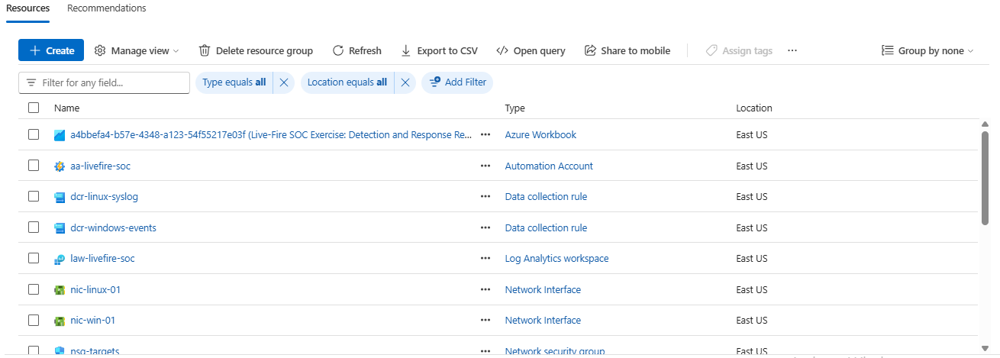
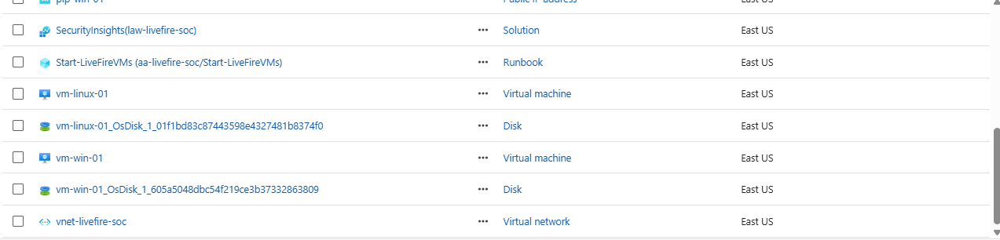
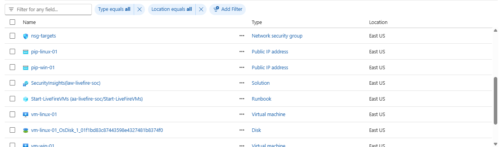

# Live-Fire SOC Range

**A live-fire Security Operations Center exercise built on Azure** intentionally vulnerable endpoints, community participants, and a two-analyst blue team detecting, hunting, and responding in real time. The range infrastructure and detections are defined as code.

---

## Overview

Most SOC portfolio projects use canned datasets or simulated attacks. This one doesn't. We deployed real vulnerable systems in Azure, invited vetted community members to attack them under a signed Rules of Engagement, and ran a live two-person SOC threat hunting, writing detections, and responding against genuinely unpredictable traffic.

The goal: demonstrate the full SOC lifecycle the way it actually happens on a real team infrastructure as code, detection as code, live triage, and a documented after-action report not a lab exercise with a known answer key.

---

## Team

| Name | Role | Profile |
|---|---|---|
| Ibrahim Idris | Lead SOC Analyst infrastructure, detection engineering, pipeline | LinkedIn: https://www.linkedin.com/in/ibrahim-idris-b5712a371 Github: https://github.com/Ibrahim-Idris1/Ibrahim-Idris1 |
| Tosin Aribisala | SOC Analyst detection validation, EDR deployment, live monitoring | Linkedin: https://www.linkedin.com/in/tosin-aribisala-0956101a1/ Github: https://github.com/ARIBISALAT |

Attackers were vetted members of our security community, operating under a signed Rules of Engagement. Their activity is fully logged and analyzed; their identities are not published anywhere in this repository or report.

---

## Architecture

```
                        ┌─────────────────────────┐
                        │   Community Attackers     │
                        │  (vetted, signed RoE)     │
                        └────────────┬───────────────┘
                                     │ attacks
                                     ▼
        ┌────────────────────────────────────────────────┐
        │              Azure Virtual Network               │
        │         (outbound locked down by default)        │
        │                                                    │
        │   ┌──────────────┐          ┌──────────────┐      │
        │   │ vm-linux-01    │          │ vm-win-01      │      │
        │   │ Ubuntu Server  │          │ Windows Server │      │
        │   │ + auditd       │          │ + Sysmon       │      │
        │   │ + LimaCharlie  │          │ + LimaCharlie  │      │
        │   └───────┬────────┘          └────────┬───────┘      │
        └────────────┼─────────────────────────────┼─────────────┘
                     │ logs                         │ logs
                     ▼                              ▼
        ┌────────────────────────────────────────────────┐
        │   Log Analytics Workspace + Microsoft Sentinel     │
        │   (SIEM — detections, incidents, hunting)           │
        └────────────────────┬───────────────────────────┘
                              │
                              ▼
                 ┌─────────────────────────┐
                 │   SOC Analysts (us)        │
                 │  Hunt · Detect · Respond   │
                 └─────────────────────────┘

        Infrastructure is defined in Terraform.
        GitHub Actions validates Terraform; it does not deploy.
```

---

## Tools and technologies

- **Infrastructure as Code:** Terraform
- **Cloud platform:** Microsoft Azure
- **SIEM:** Microsoft Sentinel
- **Log sources:** Windows Security Events, Sysmon, PowerShell Script Block Logging, Linux auditd, Syslog
- **EDR:** LimaCharlie
- **Detection as Code:** KQL analytics rules defined in Terraform
- **Validation:** GitHub Actions checks Terraform formatting and configuration; Azure deployment is not automated
- **Attack simulation / validation:** Atomic Red Team
- **Version control:** GitHub
- **Documentation:** Markdown, this repository

---

## How it works

1. **Infrastructure deploys as code.** Two endpoints (Linux + Windows) are provisioned entirely via Terraform — network, NSGs, logging pipeline, and VM configuration are all defined in `/infrastructure`.
2. **Vulnerabilities can be planted as code.** Optional Terraform-triggered scripts introduce intentionally insecure lab configurations — see `/infrastructure/vulnerabilities`. They are disabled by default and must only be enabled in an isolated, authorized range.
3. **Telemetry flows to Sentinel and LimaCharlie.** Every endpoint ships Windows Security Events, Sysmon, PowerShell logging, and Linux auditd/syslog data to a central Log Analytics workspace, plus independent EDR telemetry via LimaCharlie.
4. **Detections are defined as code.** Each detection rule lives in `/detections/rules` as a Terraform resource, mapped to MITRE ATT&CK. GitHub Actions checks Terraform formatting and validates the configuration; it does not authenticate to Azure or deploy resources.
5. **Attackers operate under signed rules.** Community participants are given scope and access only after agreeing to a documented Rules of Engagement (`/docs/rules-of-engagement.md`).
6. **The SOC hunts and responds live.** We monitor Sentinel incidents and LimaCharlie telemetry in real time, document hunts (`/hunts`) and incident findings (`/Incidents`), and validate detection coverage against Atomic Red Team simulations.
7. **Results are reported.** The after-action report (`/reports`) summarizes available event evidence and identifies analysis that remains incomplete.

---

## Repository structure

```
├── docs/                   Rules of engagement, architecture notes, setup guide
├── infrastructure/
│   ├── terraform/            Network, VMs, logging pipeline, automation schedules
│   └── vulnerabilities/      Documented, intentionally planted weaknesses
├── detections/
│   ├── rules/                 Sentinel detection rules (Terraform, KQL)
│   └── tests/                 Atomic Red Team validation mappings
├── hunts/                   Threat hunt logs
├── Incidents/                 Investigated incident findings
├── incidents/                 Incident-log guidance
├── reports/                  After-action report and metrics
└── .github/workflows/        Terraform validation workflow
```

---

## Key results

- Exercise window: October 12-23, 2026
- Incident totals remain unresolved: the report records 769 new incidents, while the included Sentinel screenshot shows 787 new and 788 open incidents (1 active) in a 14-day view. The selected range and capture time have not been reconciled, so neither count is presented as final.
- Analytics rules reported as triggered: 5 of 6; the web-shell rule did not trigger
- The analyst-reported review also lists 775 alert instances, 6 true-positive findings, and a 4-hour average time to detect. Deduplication criteria and the MTTD calculation basis remain undocumented.
- Treat all counts as preliminary, not as unique attacks or confirmed compromises; see the [after-action report](reports/after-action-report.md) for the discrepancy and remaining analysis.

Sentinel incident counts are not equivalent to unique attacks or confirmed compromises. See [`/reports/after-action-report.md`](reports/after-action-report.md) for the event summary and remaining analysis.

Full breakdown in [`/reports/after-action-report.md`](reports/after-action-report.md).

---

## Screenshots and evidence

These are point-in-time views from the Azure range and Sentinel workspace during the exercise. They illustrate the environment and analyst workflow; they are not a live inventory or a substitute for the written findings.

### Azure infrastructure and cost

**Azure resource group — monitoring and logging resources**


**Azure resource group — network security and public IP resources**


**Azure resource group — virtual machines, disks, and virtual network**


**Azure resource inventory — overview**



**Azure resource inventory — upper section**



**Azure resource inventory — lower section**



**Azure range cost snapshot — spend, forecast, and resource breakdown**


### Sentinel detections and incident cases

**Sentinel analytics rules enabled for the exercise**


**Sentinel incident queue during the exercise**


**SSH brute-force incident — case overview**


**RDP brute-force incident — case overview**


**RDP brute-force incident — attack graph and triage**


**New local account — Sentinel incident**


**Linux cron persistence — Sentinel incident**


**New service installation — Sentinel incident**


### Threat-hunting queries

**Hunt 1 — Linux cron persistence activity**


**Hunt 2 — SSH authentication around the alert window**


**Hunt 3 — Failed SSH attempts by source and time window**


**Hunt 4 — SSH brute-force volume and targeted accounts**


**Hunt 5 — SSH failures followed by successful authentication**


**Hunt 6 — SSH activity timeline for a suspicious source**


**Hunt 7 — Confirmed SSH authentication event**


**Hunt 8 — Windows RDP brute-force volume**


**Hunt 9 — RDP failures correlated with successful logons**


**Hunt 10 — Windows service installation events**


### CI workflow

**GitHub Actions — detection workflow run history**


---

## Reproducing this range

1. Clone this repository.
2. Install Terraform and the Azure CLI.
3. Follow [`docs/setup-guide.md`](docs/setup-guide.md) to create a local `terraform.tfvars` from the example and review the plan.
4. Apply only if you own the target subscription, understand the costs and exposure, and have explicitly approved the deployment.

---

## Ethics and safety

- Authorized exercise participants operated under the written Rules of Engagement; incident records also document a successful SSH authentication from an unrecognized source whose identity remains unverified.
- Outbound network access from both endpoints is locked down by default, preventing the range from being used to attack third parties.
- Participant identities are not named in the published exercise records. The project team has approved the names and profile links in this README.
- All planted vulnerabilities and configurations described here are intentionally insecure for training purposes only and must never be deployed in a production environment.
- The vulnerable configuration scripts generate unique local account and database credentials; intentionally insecure services and permissions remain. Do not enable vulnerability planting on an internet-exposed or production system.
